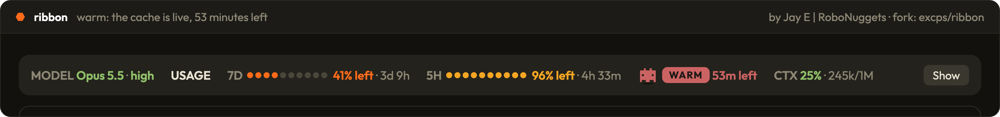
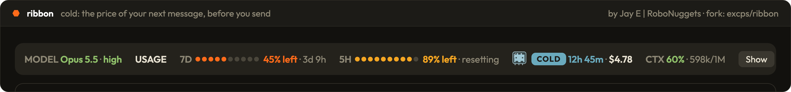
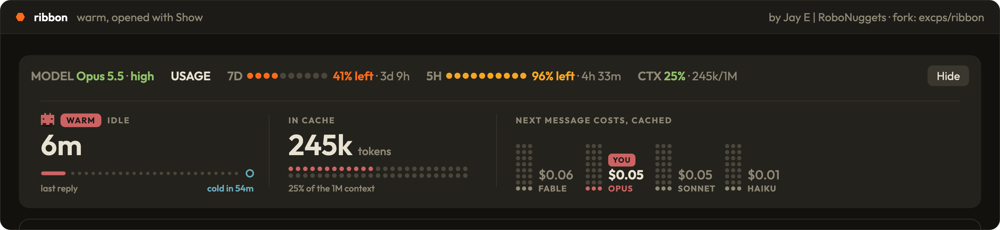
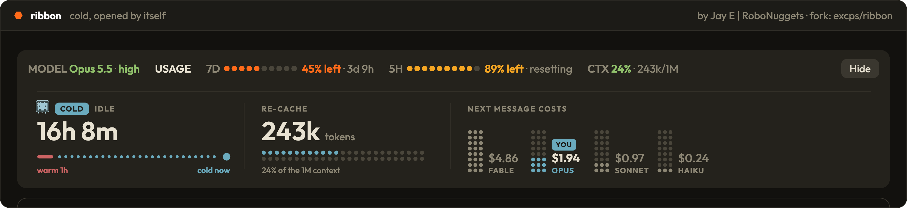

<p align="center">
  
</p>

# ribbon

> **A fork of [robonuggets/ribbon](https://github.com/robonuggets/ribbon)** by Jay E ([RoboNuggets](https://robonuggets.com)).
> This fork adds the **current model and effort** (e.g. `MODEL Opus 5.5 · high`, in green) at the start of the band and the **context window fill** (e.g. `CTX 25% · 245k/1M`) at its end.
> Everything else is the original; see upstream for its history.

A free mod for Claude Code. It adds a slim band above your prompt that shows:

- **Which model you are on and its effort**, e.g. Opus 5.5 · high (with `· 1M` on a 1M-context model; effort fills in after the first request). *(added in this fork)*
- **How full the context window is**, e.g. `CTX 25% · 50k/200k`. *(added in this fork)*
- **How much usage you have left** in your 7-day and 5-hour windows, and when each one resets.
- **Whether your prompt cache is warm or cold**, and what your next message will cost.

It installs once and is there in every session after that. No commands to learn.

<p align="center">
  
</p>

<p align="center">
  
</p>

One row. That's the whole footprint: model and effort first, context fill last.

## Install

The easy way: send this link to your agent and say "install this".

```
https://github.com/excps/ribbon
```

Your agent runs one command. The band shows up in your next session.

### For agents

If you are an agent and your user asked you to install this, run this in a shell:

```
claude plugin install ribbon --marketplace excps/ribbon
```

It installs for the user (all their projects) and adds the marketplace on its own. Then tell your user: "Ribbon is installed. Start a new session to see the band above your prompt." Do not edit their settings file by hand.

### By hand

In a Claude Code terminal session, type:

```
/plugin install ribbon --marketplace excps/ribbon
```

1. Type `y` when it asks `Add marketplace?`.
2. Pick the **user** scope with Enter.
3. Start a new session.

## What you see

### Model and effort *(fork)*

- **MODEL** shows the model this session runs, in green: `Opus 5.5`, `Sonnet 4.5`, and `· 1M` on a 1M-context model.
- Next to it is the **effort** the last request was sent with (`low`, `medium`, `high`, `xhigh`, `max`), also in green.
- `/model` switches show at once. Effort fills in after your first reply, and a `/effort` change shows with your next request, because the band reads what was actually sent. On a model without an effort setting it stays hidden.

### Context window *(fork)*

- **CTX** at the end of the line shows how full the context window is: the percent in green, then tokens used out of the window, e.g. `CTX 25% · 245k/1M`.
- It updates whenever the app measures the context, so it tracks the conversation as it grows and drops after `/compact` or `/clear`.

### Usage left

- **7D** (orange) is your 7-day window. **5H** (yellow) is your 5-hour window.
- Each dot bar shows what is **left**, not what is used.
- Under each one is when it resets, for example `resets 3d 9h`.
- If a window drops under 15%, a bold **LOW** shows next to it.

### The prompt cache

After your first reply, the band also tracks the prompt cache. The cache keeps your chat cheap to continue for one hour after your last message.

- **WARM** (red, the robot bobs): the cache is live. It shows the minutes left and what your next message costs.
- **COLD** (blue, the robot is frozen): the hour has passed. Your next message re-sends the whole chat, so it costs more. It shows the price first.

Click **Show** to open the cache card, and **Hide** to fold it. Warm starts folded. Cold starts open, so you see the price before you send.

The card shows how long you've been idle, how many tokens are in the cache, and what the next message costs on each model. Your model is marked **YOU**. See [Up close](#up-close) below.

### Fits any width

- **Wide:** everything on one row.
- **Half width:** each window stacks into a small block.
- **Narrow:** the cache moves to its own row, with the context fill at its end.
- **Terminal:** the same facts as plain text.

## Good to know

- **It costs nothing to run.** It reads the app's own numbers (usage, model, effort, context) and draws them. It never calls a model.
- **Prices are estimates.** They come from a price table in `hooks/cache-art.ts` (`MODELS`), not from your bill. If prices change, edit that table.
- **Subagents don't count.** Only your main chat resets the cache clock.

## What is inside

```
ribbon/
├── .claude-plugin/
│   ├── plugin.json         the mod's name and version
│   └── marketplace.json    makes this repo installable
├── hooks/
│   ├── hooks.json          points to the module
│   ├── register.tsx        the band: model, effort, usage, cache tracking, context, layout
│   ├── cache-art.ts        the cache card and robot drawings, the price table
│   └── font.ts             Outfit, embedded so the drawings render anywhere
├── types/index.d.ts        the shape of what the band remembers
├── tests/                  11 tests: layouts, warm and cold, terminal, cleared sessions, model, effort, context
└── assets/                 banner, screenshots, hex icon
```

## Remove it

```
claude plugin uninstall ribbon
```

## Develop it

Load the folder without installing it:

```
claude --plugin-dir ./ribbon
```

Run the tests:

```
claude plugin test ./ribbon
```

An installed plugin runs from a copy Claude Code made at install time, so edits to your clone reach it only after a version bump. Raise `version` in `.claude-plugin/plugin.json`, then:

```
claude plugin marketplace update ribbon-fork
claude plugin update ribbon@ribbon-fork
```

and restart Claude Code.

## Up close

Click **Show** and the band opens into the cache card.

**Warm.** The cache is live. Your next message is cheap.

<p align="center">
  
</p>

**Cold.** The hour has passed. Your next message re-sends the whole chat, so it costs more.

<p align="center">
  
</p>

## License

[MIT](LICENSE).

The embedded font is [Outfit](https://github.com/Outfitio/Outfit-Fonts), under the SIL Open Font License 1.1.

Made by Jay E from RoboLabs. Learn more at [RoboNuggets](https://robonuggets.com).

Model, effort and context additions in this fork by [excps](https://github.com/excps).

<p align="center">
  
</p>
